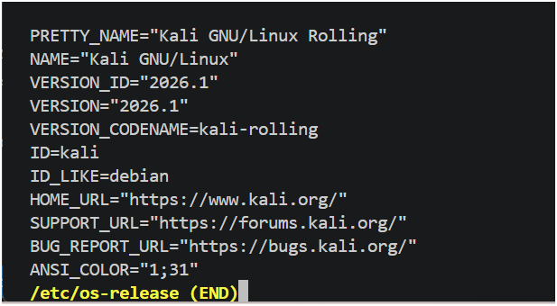
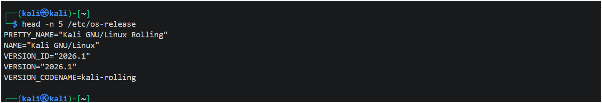
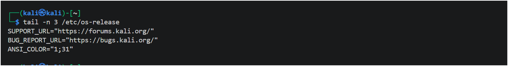
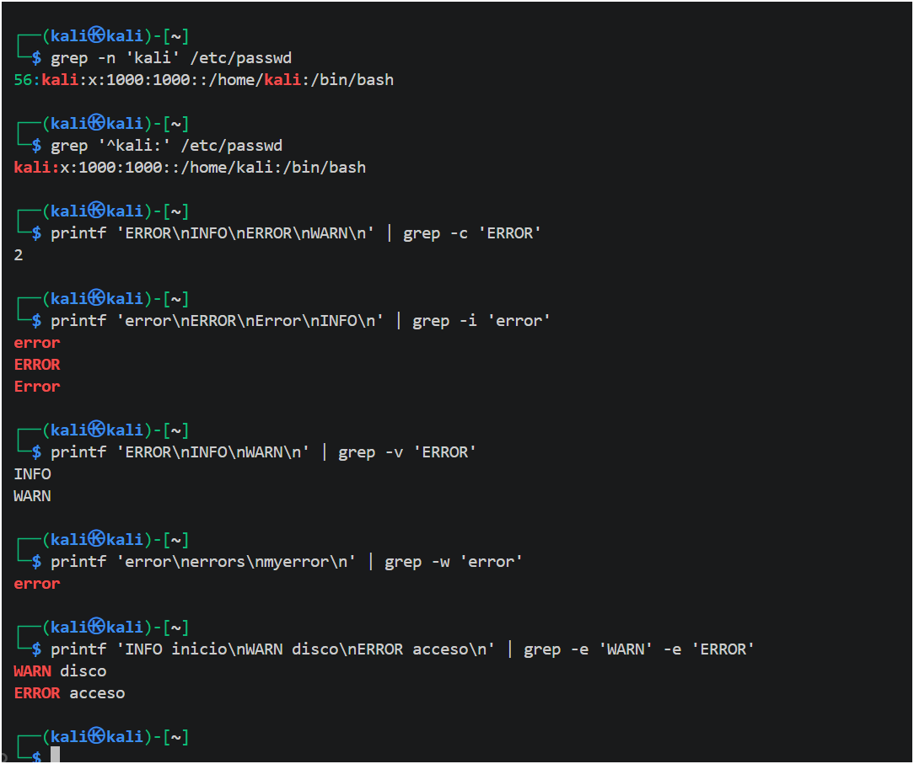
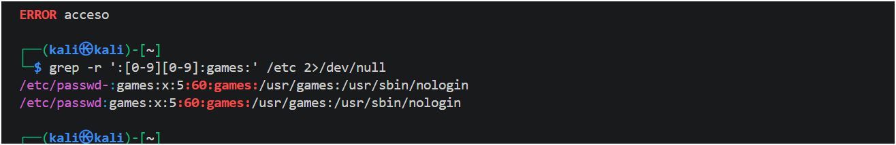
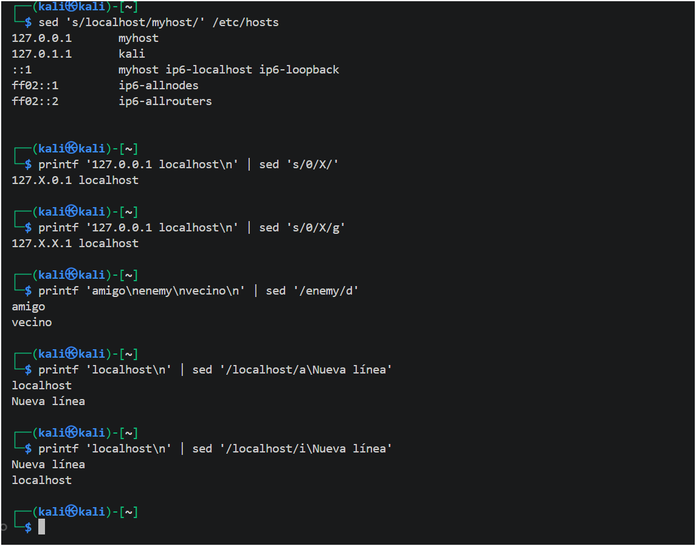
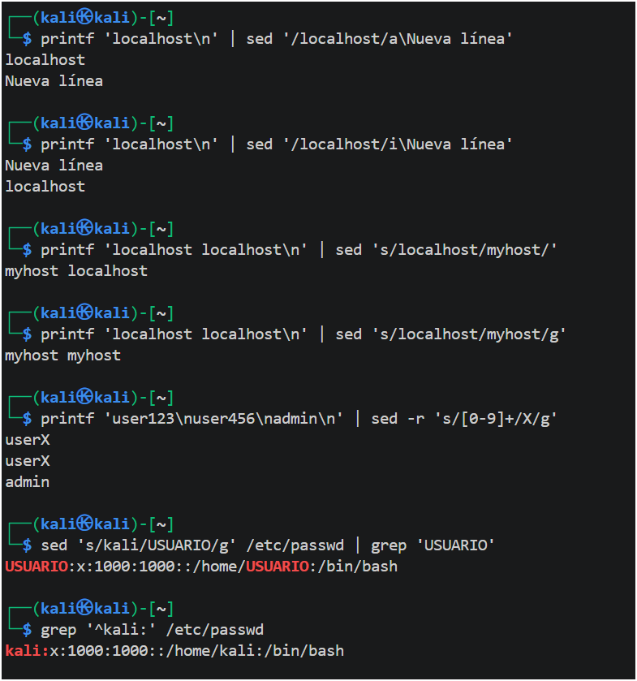
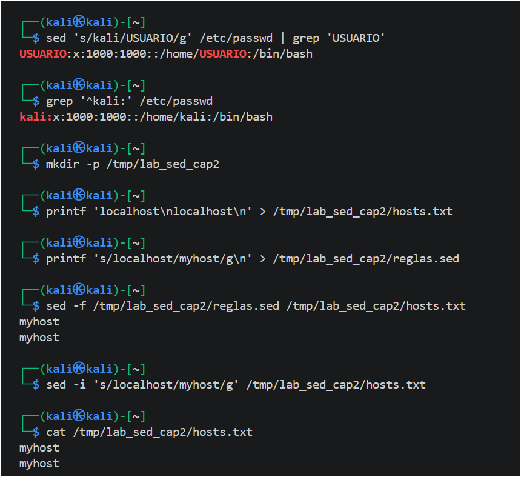

# Lab 01 — Linux Foundations & Command-Line Investigation

**Book alignment:** _Linux Essentials for Cybersecurity_ (Rothwell & Kinsey)
- **Chapter 1 — Distributions and Key Components:** distribution identification, kernel, shells, filesystems, modules, user utilities, services and virtualization.
- **Chapter 2 — Working on the Command Line:** file management, shell features, `find`, basic and extended regular expressions, `grep`, `sed`, and an introductory `tar` experiment.

**Status:** verified terminal exercises with selected original screenshots. **Scope:** personal Kali VirtualBox VM; no external targets or production systems.

## 1. Objective and laboratory boundaries

Learn the command-line operations needed to recognize the Linux environment, navigate safely, select files, interpret text patterns, transform streams and preserve reproducibility. The objective is to explain each command's precise effect, including unexpected matches, permissions and side effects.

**Rules:** use read-only inspection against system files; make edits only in a temporary workspace; use no elevated privileges; do not publish unrelated contents of the Kali home directory, passwords, keys or private configuration; make no security-vulnerability assertions without evidence.

## 2. Environment and baseline

| Component | Observation | Verification |
| --- | --- | --- |
| Distribution | Kali GNU/Linux Rolling, 2026.1 | `cat /etc/os-release` |
| Kernel | 6.12.38+kali-amd64 | `uname -r` |
| Virtualization | Oracle | `systemd-detect-virt` |
| Shell | `/bin/bash` | `getent passwd kali` |
| Root filesystem | `/dev/sda1` / ext4 | `findmnt -n -o SOURCE,FSTYPE /` |
| Boot target | `graphical.target` | `systemctl get-default` |
| SSH | Authenticated access verified | `whoami`, `hostname` |

These observations describe one lab VM at the time of testing; the outputs do not imply exposure to a public network.

## 3. Experiment A — Identify the distribution and read files

```bash
cat /etc/os-release
less /etc/os-release      # press q to exit the interactive pager
head -n 5 /etc/os-release
tail -n 3 /etc/os-release
```

**Why:** `/etc/os-release` provides OS identity; `less` pages through a file; `head` selects its first lines; `tail` selects its last lines. With `less`, **(END)** means the file ended, not that a command failed.

**Observed:** Kali Rolling release 2026.1; the first five lines included `PRETTY_NAME` and `VERSION_ID`, while the last three included the support and bug-report URLs.


*Figure 1. Paged read of the original OS identity file; the pager indicates the end of the file.*


*Figure 2. `head -n 5`: controlled extraction from the beginning of the same file.*


*Figure 3. `tail -n 3`: extraction from the end of the same file.*

## 4. Experiment B — Files, shell and deterministic command execution

Exercises included `pwd`, `cd`, `ls -la`, file globs, `file`, `mkdir`, `touch`, `cp`, `mv`, `rm` and `rmdir` using temporary data.

```bash
pwd
type pwd
type ls
command -v ls
file /etc/passwd /bin/ls /dev/null
```

**Observed:** `pwd` was a Bash builtin; `ls` resolved to `/usr/bin/ls`; `file` distinguished ASCII text, an ELF executable and a character device. The original and copied test files were compared during the experiment and the disposable workspace was removed. **No image is asserted for this sub-experiment.**

### Shell behavior examined

`HOME`, `LOGNAME`, `PWD`, `PATH`, `export`, shell initialization files, aliases, history, `stdin`/`stdout`/`stderr`, redirection and pipes. The existing `~/.bash_history` file was inspected only for metadata (mode 600), not its contents.

One lesson: `grep 'aa*'` without a filename or piped data waits for **stdin**; interrupt with Ctrl+C or finish stdin with Ctrl+D. This is expected command behavior, not a hung terminal.

## 5. Experiment C — Locate files with find

```bash
find /etc -maxdepth 2 -type f -name '*.conf' -print
find /etc -maxdepth 1 -type f -size +10k -print
find /home/kali -maxdepth 1 -type f -mmin -60 -print
find /etc -maxdepth 1 -type d -print
find /etc -maxdepth 1 -type f -name '*.conf' -exec file {} \;
find /home/kali -maxdepth 1 -nouser -print
find /home/kali -maxdepth 1 -nogroup -print
```

**Observed:** configuration files such as `/etc/inetd.conf` and `/etc/strongswan.conf`; directory and size filters returned different sets. The non-owner and non-group searches returned no matches **at the specified depth**. This is not a system-wide conclusion. `-exec` invokes `file` on each path; `-delete` was intentionally not used.

## 6. Experiment D — Regular expressions, BRE and ERE

```bash
printf 'ac\nabc\nabbc\naxc\n' | grep '^ab*c$'
printf 'ERROR login\nWARN disk\nINFO boot\n' | grep -E '^(ERROR|WARN)'
printf 'id=7\nid=42\nid=1234\nid=12345\n' | grep -E '^id=[0-9]{2,4}$'
```

**Expected semantics:** `^ab*c$` matches `ac`, `abc` and `abbc`, but not `axc`; the extended grouping/alternation matches ERROR or WARN at the line start; the quantified range matches two to four digits.

**Important:** these three demonstrations were taught as part of the lesson; no standalone screenshot or specific historical terminal output is claimed for them. The repository includes an executable reproduction script.

## 7. Experiment E — grep searches and verification

```bash
grep -n 'kali' /etc/passwd
grep '^kali:' /etc/passwd
printf 'ERROR\nINFO\nERROR\nWARN\n' | grep -c 'ERROR'
printf 'error\nERROR\nError\nINFO\n' | grep -i 'error'
printf 'ERROR\nINFO\nWARN\n' | grep -v 'ERROR'
printf 'error\nerrors\nmyerror\n' | grep -w 'error'
printf 'INFO inicio\nWARN disco\nERROR acceso\n' | grep -e 'WARN' -e 'ERROR'
```

**Observed:** `grep -n` showed the account record on line 56; `-c` returned **2**; `-i` matched three capitalization variants; `-v` left INFO/WARN; `-w` matched only the complete word; multiple `-e` patterns selected WARN and ERROR.


*Figure 4. One continuous terminal session: account record selection, counting, case folding, inverse selection, word boundaries and multiple search patterns.*

### Recursive grep and account-file duplicate

```bash
grep -r ':[0-9][0-9]:games:' /etc 2>/dev/null
```

**Observed:** matches appeared in both `/etc/passwd` and `/etc/passwd-`, including the `games` service-account line. The `/usr/sbin/nologin` shell is consistent with a non-interactive system account. The `/etc/passwd-` file is commonly a backup of the account database; its presence alone is not evidence of unauthorized activity.


*Figure 5. Regex with recursive search and stderr redirection; two matching files are visibly identified.*

## 8. Experiment F — sed stream editing and safe in-place changes

Operations explored:
- `s/old/new/`: first occurrence on each line.
- `s/old/new/g`: all occurrences on each line.
- `/pattern/d`: suppress matching lines in output.
- `a\` and `i\`: append after / insert before matching lines.
- `-r`: extended regex; `-f`: read editing instructions from a file; `-i`: edit a file on disk.

```bash
sed 's/localhost/myhost/' /etc/hosts
printf '127.0.0.1 localhost\n' | sed 's/0/X/'
printf '127.0.0.1 localhost\n' | sed 's/0/X/g'
printf 'amigo\nenemy\nvecino\n' | sed '/enemy/d'
printf 'localhost\n' | sed '/localhost/a\Nueva línea'
printf 'localhost\n' | sed '/localhost/i\Nueva línea'
```


*Figure 6. The sequence illustrates that unqualified `s` replaces the first match per line, while `g` replaces every match; `d` changes output only; `a` and `i` affect insertion order.*

```bash
printf 'localhost localhost\n' | sed 's/localhost/myhost/'
printf 'localhost localhost\n' | sed 's/localhost/myhost/g'
printf 'user123\nuser456\nadmin\n' | sed -r 's/[0-9]+/X/g'
sed 's/kali/USUARIO/g' /etc/passwd | grep USUARIO
grep '^kali:' /etc/passwd  # source remains unchanged
```

**Observed:** replacement on stdout did **not** modify `/etc/passwd`. A global substitution also affected the path `/home/kali`, demonstrating how unbounded patterns can alter more fields than intended.


*Figure 7. ERE quantifier replacing numeric suffixes and side-by-side confirmation that `/etc/passwd` is unchanged.*

### Isolated temporary edit

```bash
mkdir -p /tmp/lab_sed_cap2
printf 'localhost\nlocalhost\n' > /tmp/lab_sed_cap2/hosts.txt
printf 's/localhost/myhost/g\n' > /tmp/lab_sed_cap2/reglas.sed
sed -f /tmp/lab_sed_cap2/reglas.sed /tmp/lab_sed_cap2/hosts.txt
sed -i 's/localhost/myhost/g' /tmp/lab_sed_cap2/hosts.txt
cat /tmp/lab_sed_cap2/hosts.txt
```

**Observed:** `sed -f` displayed two `myhost` lines without changing the source; `sed -i` then updated the **temporary** file, and `cat` confirmed the new contents. These commands were deliberately not run with `-i` against `/etc/hosts`.


*Figure 8. Rules file creation, non-destructive preview, in-place edit and explicit readback of the temporary file.*

## 9. Experiment G — tar archive smoke test

A separate, real test created two small files, archived them with `tar -cf`, listed contents with `tar -tf`, extracted with `tar -xf` and checked them using `diff -r`.

**Observed:** the archive listed `./dos.txt` and `./uno.txt`; recursive comparison returned `MATCH`; TAR size was **10,240 bytes**. This demonstrates archiving without implicit compression. The temporary test directory was removed. **No screenshot is claimed** for this experiment.

## 10. Findings, caveats and lessons

| Observation | Interpretation | Boundary |
| --- | --- | --- |
| `grep` output shows `games` in two files | Recursive search finds both current/backup-like account records | Not a vulnerability report |
| `grep 'aa*'` appeared to stall | No input file/pipe causes waiting for stdin | Not a command crash |
| `sed` global replacement changed `/home/kali` in output | Pattern was broad and matched more than a username field | Source was not edited |
| `sed -i` changed temporary test data | `-i` performs file modification | No system file was altered |
| `find -nouser` found nothing at depth 1 | No match within that narrow traversal | Does not describe the entire filesystem |
| TAR occupied 10,240 bytes for tiny files | Archiving carries format overhead and block padding | Compression was not performed |

**Reproduction:** [scripts/reproduce.sh](scripts/reproduce.sh).

## 11. Evidence integrity and publication hygiene

Original terminal captures are included only when the visible command and output support a documented result. Screenshots displaying unrelated user-home filenames or possible secrets have been excluded. The lab does not publish the entire contents of account files, private keys, shell history or SSH configuration. Future exercises will follow the book's next sections and be documented separately.

**Book reference:** William Rothwell and Denise Kinsey, _Linux Essentials for Cybersecurity_, Chapter 1 and Chapter 2. All descriptions here are independently written.
