# Lab 02 — Archiving and Compression: tar, gzip & gunzip

**Series:** [Linux for Cybersecurity](../../README.md)  
**Textbook sequence:** *Linux Essentials for Cybersecurity*, Chapter 2, **Compression Commands** → **The tar Command** → **The gzip Command** → **The gunzip Command**.  
**Status:** Completed, based on original Kali terminal screenshots (21 October 2026).  
**Next section:** **The bzip2 Command** — intentionally deferred.

## Objective and scope

Demonstrate the difference between **archiving** and **compression**; create and extract a TAR archive; compare archived and on-disk data; compress and decompress with gzip/gunzip; verify recovered bytes with `cmp` and SHA-256; and investigate the impact of very small inputs and repetitive data on compressed size.

**Environment:** personally controlled Kali GNU/Linux Rolling VM, user `kali`; Bash terminal; test data only under `/tmp/lab_tar_cap2`, `/tmp/lab_tar_verificacion`, `/tmp/lab_gzip_cap2`, and `/tmp/lab_gunzip_cap2`. No production or external systems were assessed. No privileges or system-file modifications required.

> Evidence policy: the PNGs are original terminal screenshots, not generated mock-ups. The commentary distinguishes visible observations from conclusions. All sizes and return codes below come from the screenshots. The first failed TAR command is retained as a troubleshooting example.

## 1. tar — Creating an archive and diagnosing a missing source

### 1.1 First attempt: an argument that was not a real file

```bash
tar -cf sample.tar archivos
# tar: archivos: Cannot stat: No such file or directory
```

The string `archivos` was interpreted literally as a path, not as a placeholder. The command failed because that path did not exist. A subsequent `tar -tf sample.tar` produced no member listing; a container's existence alone is not proof that the expected files were archived.

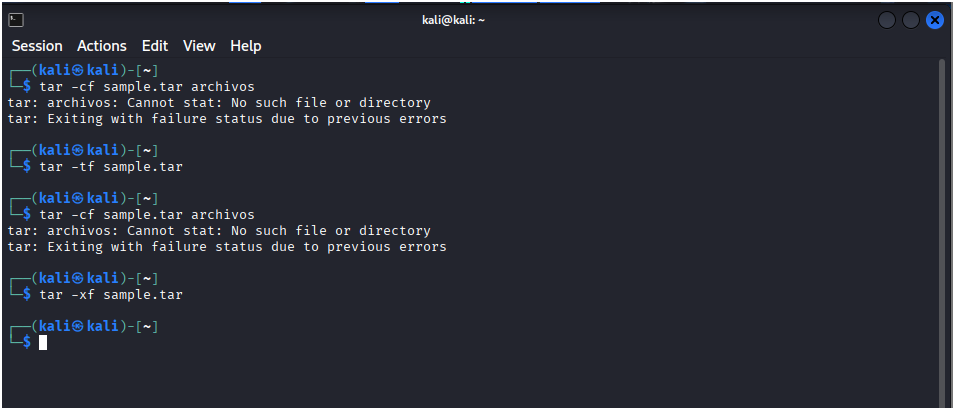
*Figure 1 — A failed source-path lookup followed by inspection of the resulting archive. This error motivated a controlled test directory.*

### 1.2 Successful archive, listing, extraction and comparison

```bash
mkdir -p /tmp/lab_tar_cap2/{origen,extraidos}
printf 'Archivo uno\n' > /tmp/lab_tar_cap2/origen/uno.txt
printf 'Archivo dos\n' > /tmp/lab_tar_cap2/origen/dos.txt

tar -cvf /tmp/lab_tar_cap2/sample.tar -C /tmp/lab_tar_cap2/origen .
tar -tvf /tmp/lab_tar_cap2/sample.tar
tar -xf /tmp/lab_tar_cap2/sample.tar -C /tmp/lab_tar_cap2/extraidos
diff -r /tmp/lab_tar_cap2/origen /tmp/lab_tar_cap2/extraidos
```

**Observed:** TAR listed `./`, `./dos.txt` and `./uno.txt`. Both text files were 12 bytes, and the verbose listing displayed permissions, owner/group and modification time. `diff -r` produced no differences in the terminal.

**Interpretation:** `-c` creates; `-t` lists; `-x` extracts; `-f` names the archive; `-v` displays details. `-C` changes directory before processing member paths, avoiding unnecessary absolute paths in the archive.

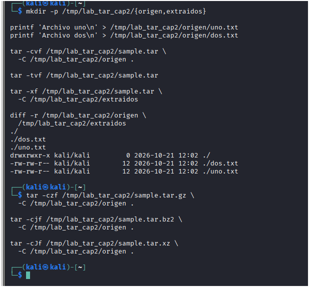
*Figure 2 — Controlled archive lifecycle with two synthetic files; the empty `diff` output is the expected success observation.*

### 1.3 Compare archive sizes with compression modes

```bash
tar -czf /tmp/lab_tar_cap2/sample.tar.gz -C /tmp/lab_tar_cap2/origen .
tar -cjf /tmp/lab_tar_cap2/sample.tar.bz2 -C /tmp/lab_tar_cap2/origen .
tar -cJf /tmp/lab_tar_cap2/sample.tar.xz -C /tmp/lab_tar_cap2/origen .
ls -lh /tmp/lab_tar_cap2/sample.tar*
```

| File | Observed size |
| --- | ---: |
| `sample.tar` | 10 KiB |
| `sample.tar.gz` | 181 bytes |
| `sample.tar.bz2` | 197 bytes |
| `sample.tar.xz` | 232 bytes |

**Interpretation:** plain TAR is not automatically compressed. The TAR format includes headers and padding. On this *tiny* dataset gzip happened to be smallest; this does not establish a universal algorithm ranking.

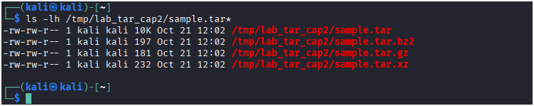
*Figure 3 — Same archived data encoded in three compression formats, with the actual output sizes visible.*

### 1.4 tar -d: comparing a saved state against a changed file

An earlier `tar -df` test already showed `Mod time differs` and `Size differs` **before** the intended edit, so it was not a clean before/after baseline. We retained that result as a troubleshooting note.

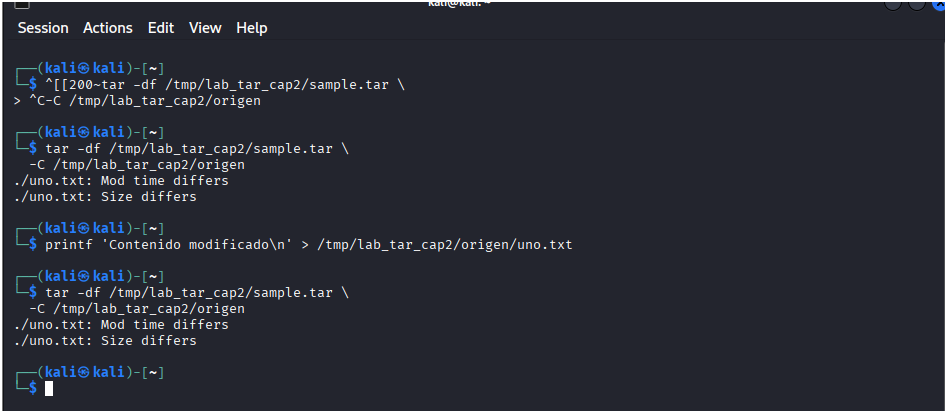
*Figure 4 — A non-clean baseline: differences were already present before the next edit. This must not be presented as proof of a clean baseline.*

A fresh, isolated verification removed that ambiguity:

```bash
mkdir -p /tmp/lab_tar_verificacion
printf 'ORIGINAL\n' > /tmp/lab_tar_verificacion/dato.txt
tar -cf /tmp/lab_tar_verificacion.tar -C /tmp/lab_tar_verificacion dato.txt
echo '=== ANTES ==='
tar -df /tmp/lab_tar_verificacion.tar -C /tmp/lab_tar_verificacion
printf 'MODIFICADO\n' > /tmp/lab_tar_verificacion/dato.txt
echo '=== DESPUÉS ==='
tar -df /tmp/lab_tar_verificacion.tar -C /tmp/lab_tar_verificacion
```

**Observed:** no differences under `ANTES`; `dato.txt: Size differs` under `DESPUÉS`.

**Interpretation:** `tar -d` can detect a changed member relative to the archived state. This is **not** a cryptographic authenticity or tamper-resistance mechanism.

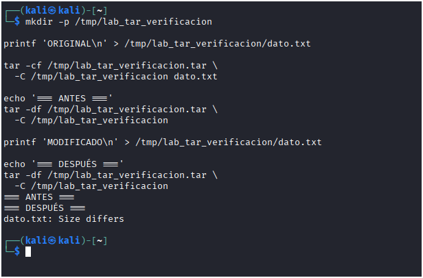
*Figure 5 — The strongest archive-comparison evidence: known baseline, controlled modification, and detection of changed size.*

## 2. gzip — Compress, decompress, preserve and recurse

### 2.1 Generate repetitive data and compress

```bash
mkdir -p /tmp/lab_gzip_cap2
yes 'Linux for Cybersecurity - laboratorio gzip' | head -n 10000 > /tmp/lab_gzip_cap2/datos.txt
ls -lh /tmp/lab_gzip_cap2/datos.txt
gzip -v /tmp/lab_gzip_cap2/datos.txt
ls -lh /tmp/lab_gzip_cap2/
```

**Observed:** `datos.txt` occupied about **420 KiB**. `gzip -v` reported **99.7%** reduction, replacing the source with `datos.txt.gz` at about **1.4 KiB**.

**Interpretation:** the input is highly repetitive; compression ratios from this synthetic dataset should not be generalized to encrypted, random or already compressed files. By default `gzip` replaces the input file with the compressed form.

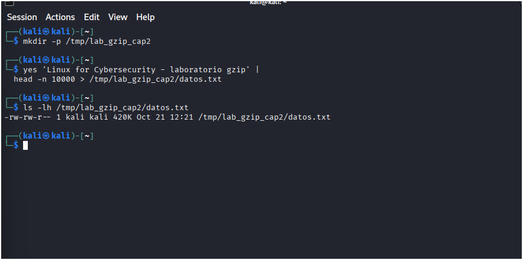
*Figure 6 — 10,000 repeated lines created as deterministic test data; the starting file size is visible.*

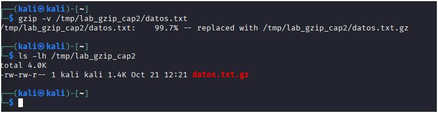
*Figure 7 — `gzip -v` output and directory listing establish both the reported reduction and replacement of the original.*

### 2.2 Recover the file

```bash
gzip -d /tmp/lab_gzip_cap2/datos.txt.gz
ls -lh /tmp/lab_gzip_cap2/
```

**Observed:** the uncompressed `datos.txt` reappeared at **420 KiB**; the `.gz` version was removed by default.

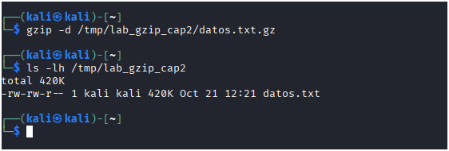
*Figure 8 — Recovered original filename and size after `gzip -d`.*

### 2.3 Preserve the source and compare bytes

```bash
gzip -c /tmp/lab_gzip_cap2/datos.txt > /tmp/lab_gzip_cap2/datos.txt.gz
gzip -dc /tmp/lab_gzip_cap2/datos.txt.gz | cmp - /tmp/lab_gzip_cap2/datos.txt
echo $?
```

**Observed:** both the text and compressed files coexisted. `cmp` returned no differences; `echo $?` displayed **0**.

**Interpretation:** `-c` writes to stdout instead of replacing the input. `cmp` verifies byte-for-byte equality of the decompressed stream and the source.

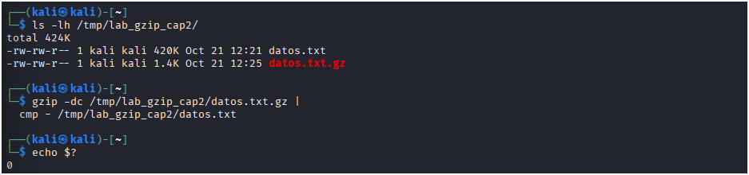
*Figure 9 — Non-destructive compression and explicit comparison, with exit status 0.*

### 2.4 gzip -r: individual compression inside a directory tree

```bash
mkdir -p /tmp/lab_gzip_cap2/directorio/subdirectorio
printf 'Archivo A\n' > /tmp/lab_gzip_cap2/directorio/a.txt
printf 'Archivo B\n' > /tmp/lab_gzip_cap2/directorio/subdirectorio/b.txt
gzip -rv /tmp/lab_gzip_cap2/directorio
find /tmp/lab_gzip_cap2/directorio -type f
```

**Observed:** `a.txt.gz` and `subdirectorio/b.txt.gz` were created in place; `gzip -v` displayed **-20.0%** for each tiny file.

**Interpretation:** `gzip -r` compresses files *individually*, not into one combined archive. Negative savings reflect compression-format overhead for very small inputs.

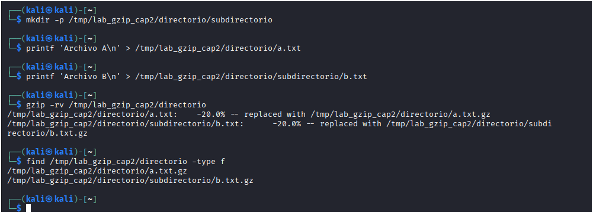
*Figure 10 — Recursion and two separate .gz outputs; negative compression savings are visible.*

## 3. gunzip — Recovery and integrity checks

### 3.1 Recover the original with gunzip

```bash
mkdir -p /tmp/lab_gunzip_cap2
printf 'Linux Cybersecurity\n%.0s' {1..1000} > /tmp/lab_gunzip_cap2/original.txt
gzip /tmp/lab_gunzip_cap2/original.txt
gunzip -v /tmp/lab_gunzip_cap2/original.txt.gz
ls -lh /tmp/lab_gunzip_cap2/
```

**Observed:** a **123-byte** `.gz` expanded to a roughly **20 KiB** text file; `gunzip -v` reported **99.5%** compression in the archive. A mistyped `mkdir` invocation appeared earlier in the session, was corrected, and did not affect the valid test.

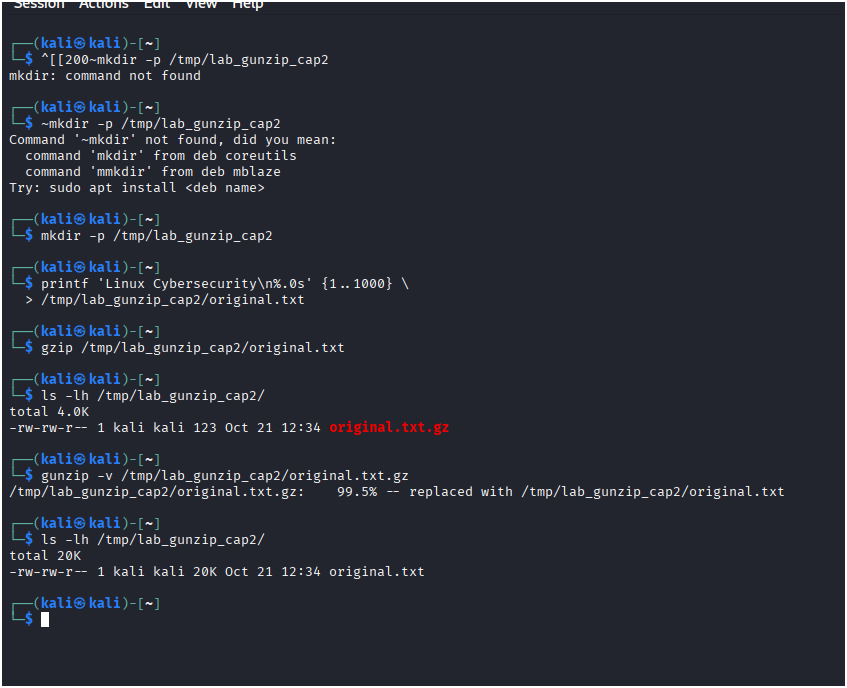
*Figure 11 — Initial typo, correction, compressed-file size and successful decompression. The troubleshooting is preserved rather than concealed.*

### 3.2 Keep the compressed file with -c

```bash
gzip /tmp/lab_gunzip_cap2/original.txt
gunzip -c /tmp/lab_gunzip_cap2/original.txt.gz > /tmp/lab_gunzip_cap2/recuperado.txt
ls -lh /tmp/lab_gunzip_cap2/
```

**Observed:** `original.txt.gz` (123 bytes) and `recuperado.txt` (~20 KiB) coexist.

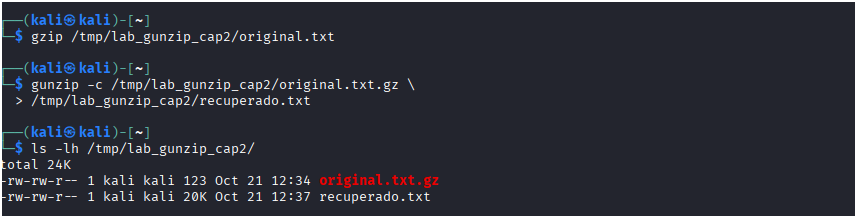
*Figure 12 — `gunzip -c` streams decompressed bytes to a new file without deleting the compressed input.*

### 3.3 SHA-256 and gzip stream validation

```bash
gunzip -c /tmp/lab_gunzip_cap2/original.txt.gz | sha256sum
sha256sum /tmp/lab_gunzip_cap2/recuperado.txt
gzip -t /tmp/lab_gunzip_cap2/original.txt.gz
echo $?
```

**Observed:** both SHA-256 values matched:

```text
7b5e0e77d0b66aab8f6caf5933c74394532b093b96b478cb86b04d133e183728
```

`gzip -t` returned exit status **0**.

**Interpretation:** matching SHA-256 values provide strong evidence that the two recovered byte streams are identical. `gzip -t` checks the compressed stream for detected corruption; it does not prove who created the archive or authenticate its origin.

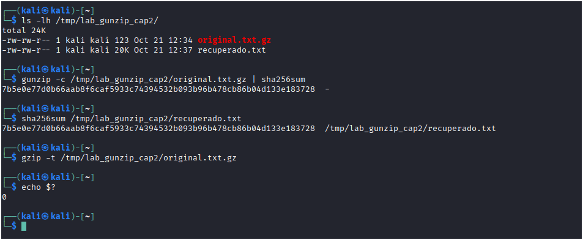
*Figure 13 — Matching SHA-256 digests and a successful gzip integrity test.*

## 4. Consolidated findings

| Experiment | Result | Lesson |
| --- | --- | --- |
| TAR missing input | `Cannot stat` | Verify paths and command exit status; do not trust archive existence alone |
| TAR create/extract | Files restored; `diff` silent | Archive operations can preserve this simple dataset |
| TAR size comparison | 10 KiB vs 181/197/232 bytes | Archive and compression are distinct operations |
| TAR controlled comparison | Clean before, size difference after | Archive-relative changes are detectable |
| gzip repetitive data | ~420 KiB → ~1.4 KiB | Redundancy strongly influences compressibility |
| gzip recursive tiny files | -20.0% | Compression overhead can exceed savings |
| gzip `-c` and `cmp` | Exit 0 | Decompressed data matched original |
| gunzip `-c` | Original .gz retained | stdout supports non-destructive workflows |
| SHA-256 + gzip `-t` | Matching hashes, exit 0 | Byte equality and stream consistency checked separately |

## 5. Limits and next step

These are **local, controlled demonstrations**, not a general performance benchmark. No claim is made about security vulnerabilities or algorithm superiority. No evidence of `bzip2` as a standalone command has been recorded in this lab; it is the **next planned textbook section**, deliberately left for a later session.

## 6. Evidence provenance

The 13 PNGs under [evidence/](evidence/) are original terminal captures provided during the training session and preserved under descriptive filenames. They are not simulated outputs. The README places each image immediately after the experiment it supports and explains what is visible, including initial errors and limitations. The complete evidence index is in [evidence/README.md](evidence/README.md).

**Reference:** William Rothwell and Denise Kinsey, *Linux Essentials for Cybersecurity*, Chapter 2, Compression Commands. This is an independent practical write-up; no textbook pages or figures are reproduced.
